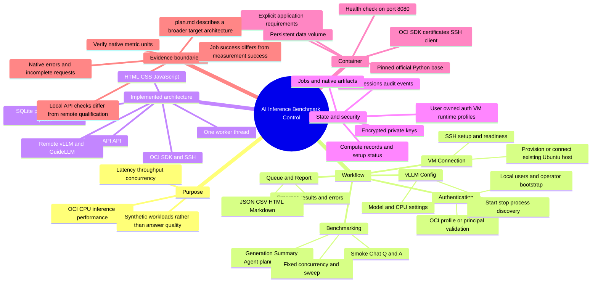

# AI Inference Benchmark Control

Reviewed after workspace cleanup on 9 October 2026. This application coordinates OCI CPU model serving and synthetic performance benchmarks. Remote Ubuntu hosts run vLLM and GuideLLM; the container hosts the UI, API, persisted state, and worker.

Active code is in `apps/benchmark-control/app`. The remaining root `plan.md` describes a broader target; React/PostgreSQL/Redis/Celery are not implemented here. The older `apps_local`, root architecture documents, runbooks, and historical `output` evidence were removed by the user during cleanup.

The worker handles health checks, VM provision/destroy, runtime start/stop, and benchmarks. Interrupted running jobs are marked failed after restart. SQLite has nine tables for users, sessions, VM profiles, setup status, OCI auth, compute instances, runtime profiles, jobs, and audit events.

Local source setup pins vLLM 0.30.0 CPU and GuideLLM 0.8.0 for the remote host. Local defaults include a 40 GiB KV cache and a 4096/512-token summary preset. These settings must be validated against the selected VM/model. The control container does not download or run a model itself.

Known source caveats: native request latency is copied into fields named `e2e_ms_*` without unit conversion; failed request totals merge errors and incompletes; false cache toggles inherit runtime defaults; nonzero GuideLLM exit raises before artifact normalization. These are benchmark qualification issues, separate from container build/start checks.

Source references: `app/main.py`, `db.py`, `worker.py`, `benchmark.py`, `ssh_client.py`, `vllm.py`, `security.py`, `oci_ops.py`, and `static/app.js`.
